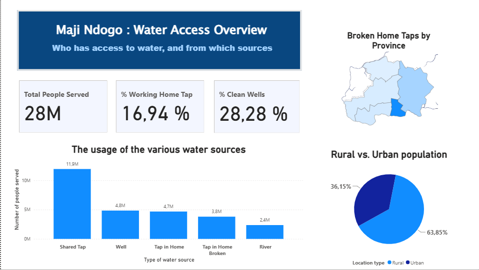
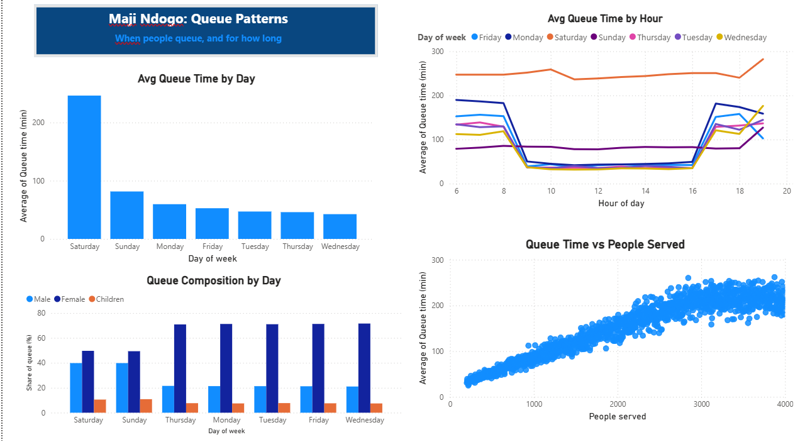
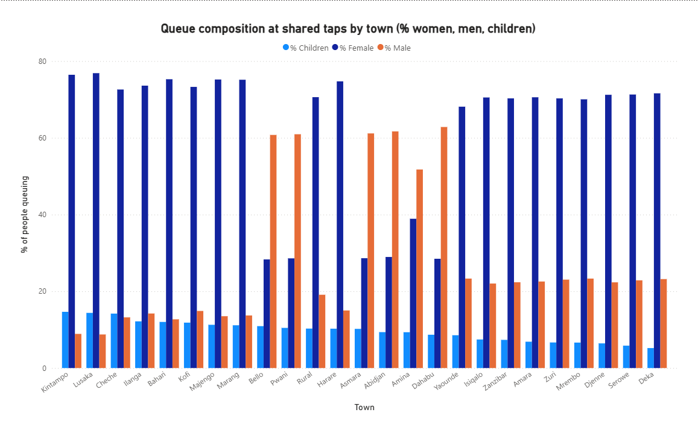
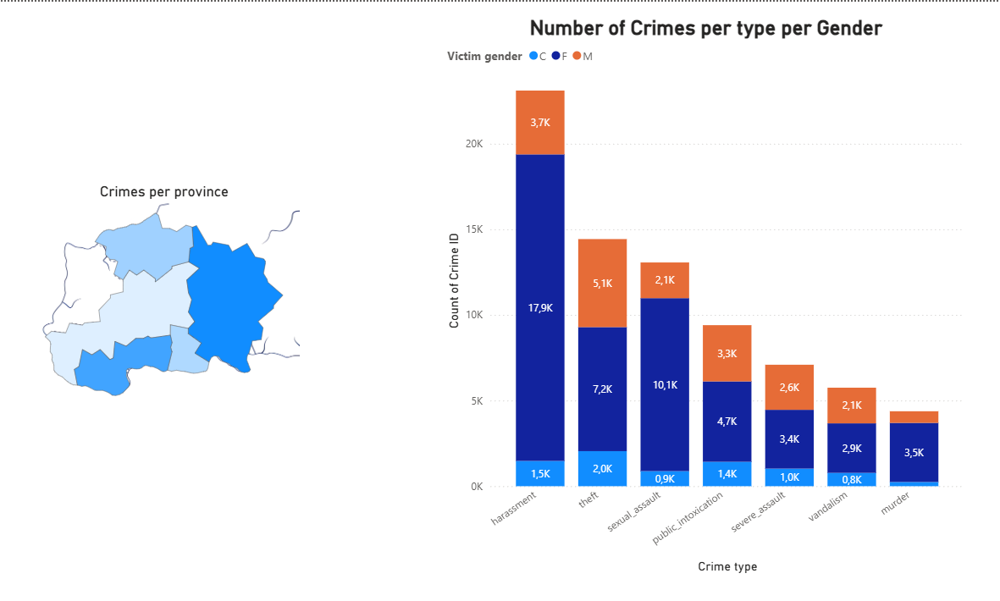

# 💧 Maji Ndogo - Water Access Dashboard (Power BI)

An interactive Power BI report on water access in Maji Ndogo, built for **government decision-makers and funders**.
It answers four questions: *Who has access to water? Where is the infrastructure failing? How long do people queue? Who is at risk?*

Built during the **ALX Africa Data Analytics program** (ExploreAI case study).



---

## 🎯 Objective

Turn a ~60,000-record water survey into a clear, decision-ready report:
- show the national picture of water access,
- locate broken infrastructure to prioritise repairs,
- reveal queue patterns and who carries the burden of collecting water,
- link water access to safety risks.

---

## 📊 Report pages

| Page | What it shows |
|---|---|
| **National** | Population served, water source mix, rural vs urban split, broken home taps by province |
| **Queue Patterns** | Queue times by day and hour, queue length vs time, queue composition by day |
| **Who Collects Water** | Share of women, men and children in queues, by town |
| **Crime** | Crimes near water sources by type, province and victim gender |

---

## I- Key insights

- **~28M people** are covered by the survey; **64% live in rural areas**.
- **Shared taps serve 43% of the population (11.9M people)**, more than double any other source.
- **Only 17% of people have a working tap at home**: 31% have home infrastructure, but 45% of it is broken. **Amanzi and Kilimani** are the priority provinces for repairs.
- **Only 28% of wells are clean**, so the main alternative to taps is often unsafe.
- **Saturdays have by far the longest queues**; on weekdays, queues peak early in the morning and in the evening.
- **Queue time rises almost linearly with the number of people served**, then plateaus around 3,000 people (people give up and look for water elsewhere).
- **Women make up 70–77% of queues in most towns**, but in a few towns (Bello, Pwani, Asmara, Abidjan, Dahabu) men are the majority, a pattern worth investigating.
- **Women are disproportionately affected by crime near water sources**, harassment being the most frequent type.

---

## II- Recommendations

- **Add taps at overcrowded shared sources**: since queue time scales with the number of users, one extra tap at a source serving 3,000 people roughly halves the waiting time.
- **Prioritise repairs in Amanzi and Kilimani**, where broken home infrastructure is concentrated.
- **Treat or replace contaminated wells**, starting with the provinces where most wells are polluted.
- **Improve safety around water points** during peak hours, as women and children are most exposed.

---

## III- Data quality work

- **Fixed population double-counting**: the data is recorded per *visit*, so shared taps (visited up to 8 times) were counted several times, inflating the total to 70M. A DAX measure filtering on the first visit brings it back to the correct ~28M.
- **Detected a data anomaly**: some records showed 3,000-person queues lasting only 30 minutes; these were excluded from the queue analysis.
- **Cleaned labels for readability**: renamed raw columns (`time_in_queue`, `type_of_water_source`…) and values (`shared_tap` → Shared Tap…) for a non-technical audience.
- **Fixed data types** for percentage columns imported as text.

---

## IV- Key DAX measures

```dax
-- Population without double-counting (data is recorded per visit)
Total People Served =
CALCULATE(
    SUM('Md_summary'[People served]),
    'Md_summary'[Visit Count] = 1
)

-- Share of people with a working tap at home
% Working Home Tap =
DIVIDE(
    CALCULATE(
        SUM('Md_summary'[People served]),
        'Md_summary'[Visit Count] = 1,
        'Md_summary'[Water source type] = "Tap in Home"
    ),
    [Total People Served]
)

-- Share of clean wells (each well counted once)
% Clean Wells =
DIVIDE(
    CALCULATE(
        DISTINCTCOUNT('Md_summary'[source_id]),
        'Md_summary'[Water source type] = "Well",
        'Md_summary'[Pollution status] = "Clean"
    ),
    CALCULATE(
        DISTINCTCOUNT('Md_summary'[source_id]),
        'Md_summary'[Water source type] = "Well"
    )
)
```

---

## V- Tools & techniques

- **Power BI Desktop**: Power Query, data modelling, custom shape map (provinces)
- **DAX measures**: `CALCULATE`, `DIVIDE`, `DISTINCTCOUNT`
- **Dashboard design**: KPI cards, consistent colour palette, interactive cross-filtering (click a province or a bar to filter the page)

---

## VI- Screenshots

| | |
|---|---|
|  |  |
|  | |

---

## 📁 Files

- `.png` files: dashboard page screenshots

---

## 🙏 Credits

Case study and data: **ALX Africa Data Analytics program** / ExploreAI Academy.
